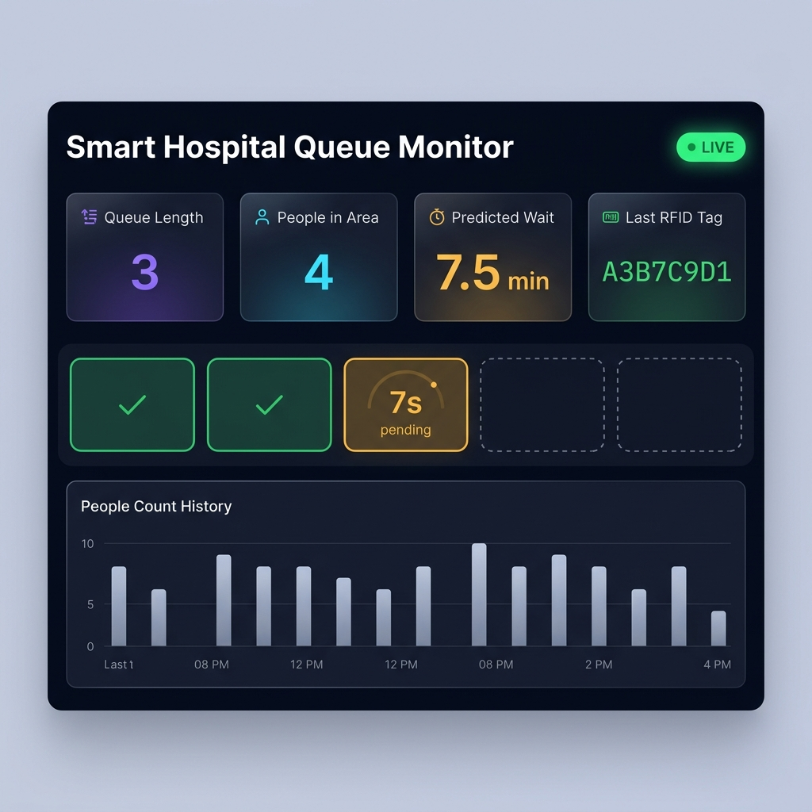
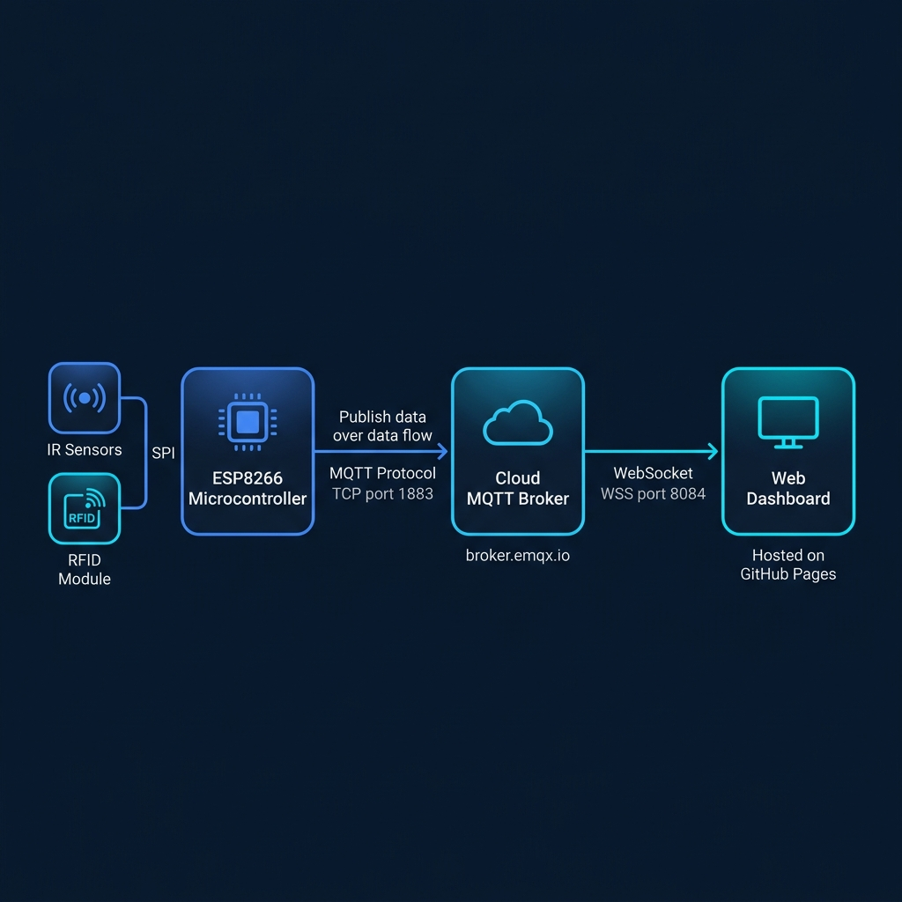
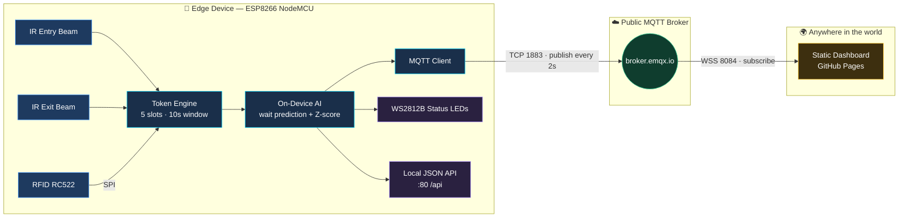
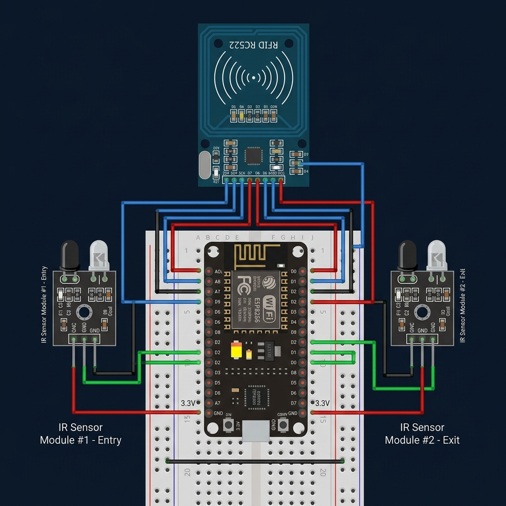

<div align="center">

# 🏥 AIoT Smart Hospital Queue &amp; Crowd Monitoring System

**An ESP8266-based edge-AI system that counts patients, verifies them by RFID, predicts waiting time on-device, and streams it live to a public web dashboard — with no backend server.**

[](https://eashan4.github.io/smart-hospital-queue-system/)
[](LICENSE)

[](https://github.com/Eashan4/smart-hospital-queue-system/actions/workflows/ci.yml)


-00979D?logo=arduino&logoColor=white)


### 🔴 [**View the live dashboard →**](https://eashan4.github.io/smart-hospital-queue-system/)

</div>

---

## 📖 Overview

Hospital outpatient departments have a simple, expensive problem: **nobody knows how long the wait actually is.** Patients queue blindly, staff field the same question all day, and crowding goes unnoticed until it becomes a safety issue.

This project solves it with a self-contained AIoT device. A single **ESP8266 NodeMCU** sits at a department entrance with two IR beams and an RFID reader. It counts people in and out, requires each patient to authenticate with an RFID card, runs a **wait-time prediction model and a Z-score anomaly detector directly on the microcontroller**, and publishes the resulting state to a public MQTT broker every two seconds.

A static dashboard hosted on **GitHub Pages** subscribes to that same broker over secure WebSockets and renders live metrics to anyone in the world — no server, no database, no cloud account, no hosting bill.


### Why it's interesting

| | |
|---|---|
| 🧠 **AI on an 80 MHz MCU** | Wait-time regression and anomaly detection run in firmware — no inference server, no round trip. |
| 🌐 **Genuinely backendless** | The live dashboard is a single static `index.html`. Hosting cost is zero and it scales to any number of viewers. |
| 🎫 **Anti-spoof token system** | A person is only counted as a real patient once RFID confirms them within a 10-second window. |
| ⚡ **~2 second end-to-end latency** | Sensor edge → MQTT publish → browser repaint. |
| 🔌 **Two deployment modes** | Run standalone at the edge, or pipe data into the Flask + scikit-learn backend for heavier offline modelling. |

---

## 🖥️ Dashboard Preview

<div align="center">
  
  <br>
  <em>The live GitHub Pages dashboard — updates roughly every 2 seconds from MQTT.</em>
</div>

The dashboard surfaces, in real time:

- **Queue length**, **people in area**, **predicted wait**, and **last RFID tag**
- A **5-slot token grid** with live countdown rings for patients pending RFID verification
- **People-count history** chart
- The model's live **feature values** — rolling average, entry velocity, queue pressure, and anomaly Z-score
- Session totals: entries, exits, RFID scans, expired tokens, data points
- Connection state, AI model state (`warming up` → `ready`), and device uptime

---

## 🏗️ Architecture

<div align="center">
  
</div>



### Data flow, step by step

1. A person breaks the **entry IR beam** → falling-edge detected (300 ms debounce) → a **token** is created in `PENDING` state with a 10-second timer.
2. They tap an **RFID card** on the RC522 within that window → the token flips to `VERIFIED` and joins the official queue.
3. No tap within 10 seconds → the token **expires** and the crowd count reverts. This is what keeps passers-by from inflating the numbers.
4. Breaking the **exit IR beam** removes the oldest verified token.
5. Every loop the firmware recomputes features and the wait-time prediction; every **2 seconds** it serializes state to JSON and publishes it to the MQTT topic.
6. The browser dashboard, subscribed over WSS, repaints on each message.

---

## 🧠 The On-Device AI

Everything below runs in firmware on the ESP8266 — there is no inference server in the loop.

**Features** computed over a rolling 50-sample history:

| Feature | Definition |
|---|---|
| `rolling_avg_people` | Moving average of people count across the history buffer |
| `entry_velocity` | Rate of change of people count — how fast the room is filling |
| `queue_pressure` | `queue_length / (people_count + 1)` — how backed-up the queue is relative to occupancy |

**Wait-time prediction** — a weighted model blending the instantaneous estimate, historical average, and queue pressure, with a surge term when people are arriving quickly:

```
predicted_wait = 0.6 · raw_wait
               + 0.3 · avg_historical_wait
               + 0.1 · (queue_pressure × 5)
               + 0.5 · entry_velocity      ← only when entry_velocity > 0
```

where `raw_wait = verified_queue_length × AVG_SERVICE_TIME_MIN` (default **2.5 min/patient**).

**Anomaly detection** — a Z-score over the people-count history. Once at least 5 samples exist, the firmware flags an anomaly when:

```
|current_people − mean| / σ  >  2.0
```

This catches sudden crowd surges or sensor faults. Below 5 samples the model reports `warming_up` and the dashboard says so rather than guessing.

---

## 📁 Repository Structure

```
.
├── index.html                  # 🌐 Live GitHub Pages dashboard (MQTT over WebSocket)
│                               #    Must stay at repo root — Pages serves from here.
├── firmware/
│   └── esp_code/
│       └── esp_code.ino        # 🔌 ESP8266 sketch: sensors, token engine, AI, MQTT, LEDs
│                               #    Folder name matches the sketch name, as Arduino IDE requires.
├── server/                     # 🐍 OPTIONAL Flask + scikit-learn backend (see below)
│   ├── app.py                  #    REST API: /sensor, /status, /history, /train
│   ├── ml_engine.py            #    RandomForestRegressor + IsolationForest
│   ├── data_handler.py         #    CSV persistence layer
│   ├── config.py               #    Environment-driven configuration
│   ├── requirements.txt
│   ├── .env.example            #    Copy to .env and fill in
│   ├── data.csv                #    Sensor dataset
│   ├── templates/index.html    #    Server-rendered dashboard
│   ├── static/                 #    CSS + JS for the server dashboard
│   └── tests/test_api.py       #    API smoke tests (stdlib unittest)
├── images/                     # 📸 Architecture, wiring, and dashboard diagrams
├── .github/
│   ├── workflows/ci.yml        # ✅ Backend tests + dashboard entry-point check
│   └── ISSUE_TEMPLATE/         #    Structured bug / feature forms
├── CONTRIBUTING.md
├── LICENSE                     # MIT
└── README.md
```

---

## 🔧 Hardware

### Bill of Materials

| # | Component | Notes |
|---|---|---|
| 1 | **ESP8266 NodeMCU** (ESP-12E) | Main controller, onboard WiFi |
| 2 | **IR obstacle sensor module** ×2 | Entry and exit beams, active LOW |
| 3 | **RFID-RC522** reader + cards | **3.3 V only** — 5 V will destroy it |
| 4 | **WS2812B LED strips** *(optional)* | 5 patient + 4 RFID + 2 IR status LEDs |
| 5 | Breadboard, jumper wires, 5 V USB supply | |

### Pinout

> ⚠️ **`RST` moved from D4 to D0.** D4 (GPIO2) is now driving the RFID status LEDs, because GPIO16/D0 cannot drive WS2812B NeoPixels. Wire against **this table**, not the older diagram below.

**RFID RC522 (SPI)**

| RC522 Pin | NodeMCU Pin | GPIO |
|---|---|---|
| SDA / SS | `D8` | GPIO15 |
| SCK | `D5` | GPIO14 |
| MOSI | `D7` | GPIO13 |
| MISO | `D6` | GPIO12 |
| RST | `D0` | GPIO16 |
| VCC | `3V3` | — |
| GND | `GND` | — |

**IR sensors**

| Sensor | NodeMCU Pin | GPIO |
|---|---|---|
| IR Entry `OUT` | `D2` | GPIO4 |
| IR Exit `OUT` | `D1` | GPIO5 |

**WS2812B status LEDs** *(optional)*

| Strip | Count | NodeMCU Pin | GPIO |
|---|---|---|---|
| Patient token LEDs | 5 | `D3` | GPIO0 |
| RFID status LEDs | 4 | `D4` | GPIO2 |
| IR entry LEDs | 2 | `RX` | GPIO3 |

### Wiring Reference

<div align="center">
  
  <br>
  <em>IR + RFID wiring reference. Note: this diagram predates the D0/D4 swap and does not
  show the optional WS2812B strips — follow the pinout tables above where they differ.</em>
</div>

---

## 🚀 Quick Start

### 1 — Install the Arduino toolchain

Add the ESP8266 board package in **Arduino IDE → Preferences → Additional Board Manager URLs**:

```
http://arduino.esp8266.com/stable/package_esp8266com_index.json
```

Then install these via **Tools → Manage Libraries**:

| Library | Author |
|---|---|
| `MFRC522` | miguelbalboa |
| `ArduinoJson` (v6+) | bblanchon |
| `PubSubClient` | Nick O'Leary |
| `Adafruit NeoPixel` | Adafruit |

`ESP8266WiFi`, `ESP8266WebServer`, `LittleFS`, and `SPI` ship with the board package.

### 2 — Configure the firmware

Open `firmware/esp_code/esp_code.ino` and set your credentials and a **unique** MQTT topic:

```cpp
String wifiSSID     = "YOUR_WIFI_NAME";
String wifiPassword = "YOUR_WIFI_PASSWORD";

String mqttServer   = "broker.emqx.io";
int    mqttPort     = 1883;
String mqttTopic    = "yourname/hospital/queue/data";   // ← make this unique
```

> 🔒 **`broker.emqx.io` is a free public broker with no authentication.** Anyone who
> guesses your topic can read your data, and anyone can publish to it. Pick a long,
> unique topic string, and never put patient-identifying information in the payload.
> For anything beyond a demo, move to an authenticated broker (see [Security](#-security-notes)).

These values can also be changed at runtime from the device's built-in settings page — see [Runtime configuration](#runtime-configuration).

### 3 — Point the dashboard at the same topic

Open `index.html` and set the default topic to **exactly** the string you used in the firmware:

```javascript
var currentTopic = 'yourname/hospital/queue/data';
```

> These two must match or the dashboard will sit on "Waiting for ESP8266 data…". You can also change the topic live from the dashboard's topic bar without redeploying.

### 4 — Flash the device

1. **Tools → Board →** `NodeMCU 1.0 (ESP-12E Module)`
2. Select the correct port, then **Upload**
3. Open Serial Monitor at **115200 baud**. A healthy boot looks like:

```
[WiFi]  ✓ Connected — IP: 192.168.x.x
[MQTT]  ✓ Connected!
[MQTT]  Publishing to topic: yourname/hospital/queue/data
[MQTT]  ✓ Published 512 bytes
[SERVER] Web server started on port 80
```

### 5 — Publish the dashboard

`index.html` at the repo root is already wired for GitHub Pages:

**Settings → Pages → Source → Deploy from a branch → `main` / `(root)` → Save**

Your dashboard goes live at `https://<username>.github.io/<repo>/` — for this repository, that's
**[eashan4.github.io/smart-hospital-queue-system](https://eashan4.github.io/smart-hospital-queue-system/)**.

Because the page talks directly to the broker from the browser, it works for any viewer, anywhere, with no server in between.

---

## 📡 MQTT Reference

| Setting | Value |
|---|---|
| Broker | `broker.emqx.io` |
| Device port | `1883` (TCP) |
| Browser port | `8084` (WSS — `wss://broker.emqx.io:8084/mqtt`) |
| Protocol | MQTT v3.1.1 |
| QoS | 0 (fire and forget), non-retained |
| Publish interval | 2000 ms |

**Alternative free brokers** — change `mqttServer` in the sketch and the `mqtt.connect(...)` URL in `index.html`:

| Broker | TCP | WSS |
|---|---|---|
| `test.mosquitto.org` | 1883 | 8081 |
| `broker.hivemq.com` | 1883 | 8884 |

### Payload schema

Published every 2 seconds, and served identically from the device's local `GET /api`:

```jsonc
{
  "people_count":       4,          // active tokens (in the area)
  "queue_length":       3,          // RFID-verified tokens (real queue)
  "pending_count":      1,          // awaiting RFID verification
  "rfid_tag":           "A3B7C9D1", // last scanned UID
  "predicted_wait":     7.5,        // minutes
  "anomaly":            false,
  "anomaly_z_score":    0.84,
  "rolling_avg_people": 3.62,
  "entry_velocity":     1,
  "queue_pressure":     0.6,
  "total_entries":      27,
  "total_exits":        23,
  "total_rfid_scans":   25,
  "total_expired":      2,
  "history_count":      50,
  "uptime_sec":         3814,
  "model_status":       "ready",    // "warming_up" until 5 samples
  "tokens": [
    { "slot": 0, "active": true,  "verified": true,  "token_id": 12, "rfid": "A3B7C9D1", "remaining_ms": 0 },
    { "slot": 1, "active": true,  "verified": false, "token_id": 13, "rfid": "",         "remaining_ms": 6200 },
    { "slot": 2, "active": false, "verified": false, "token_id": 0,  "rfid": "",         "remaining_ms": 0 }
    // … 5 slots total
  ]
}
```

### Runtime configuration

The device also serves a small config UI on the LAN, so you can re-point WiFi, broker, topic, and LED brightness without reflashing:

| Endpoint | Method | Purpose |
|---|---|---|
| `/` | GET | Embedded local dashboard |
| `/api` | GET | Live JSON state (same schema as MQTT) |
| `/settings` | GET | Settings form (WiFi, MQTT, LEDs) |
| `/save_settings` | GET | Persist settings to LittleFS (`/env.json`) |

Reach it at `http://<device-ip>/` — the IP is printed to Serial on boot.

---

## 🐍 Optional Flask + scikit-learn Backend

The `server/` directory carries the project's original architecture, originally developed as a separate repository. **It is entirely optional** — the live system does not depend on it.

It exists for the cases the edge model can't cover: training heavier models on accumulated history, batch analysis, and keeping a durable CSV record.

> ℹ️ **Note:** the current firmware publishes over MQTT and does **not** POST to this
> backend. To use it, either feed `/sensor` from an MQTT→HTTP bridge, post to it manually,
> or add an `ESP8266HTTPClient` call to the sketch. Treat this as a research/offline path.

**What it does differently from the edge model:**

| | Edge (firmware) | Server (`server/`) |
|---|---|---|
| Wait prediction | Weighted moving-average | `RandomForestRegressor` (100 trees) |
| Anomaly detection | Z-score threshold | `IsolationForest` (contamination 0.1) |
| Feature scaling | none | `StandardScaler` |
| Storage | 50-sample RAM buffer | `data.csv`, unbounded |
| Readiness rule | ≥ 5 samples | ≥ `MIN_DATA_THRESHOLD` rows (default 10) |

Both refuse to invent numbers: below the threshold they report `not_ready` rather than returning a guess.

### Running it

Requires **Python 3.9+**.

```bash
cd server
python -m venv venv && source venv/bin/activate     # Windows: venv\Scripts\activate
pip install -r requirements.txt
cp .env.example .env                                 # then edit .env
python app.py
```

Open <http://localhost:5000>.

### Tests

```bash
cd server
python -m unittest discover -s tests -v
```

The suite drives the API through Flask's test client and writes to a temporary CSV, so it
binds no port and leaves the committed `data.csv` untouched. It runs in CI on Python 3.9
and 3.12.

### API

| Endpoint | Method | Description |
|---|---|---|
| `/` | GET | Server-rendered dashboard |
| `/sensor` | POST | Ingest a reading — `{rfid_tag, people_count, queue_length, wait_time}` |
| `/status` | GET | Device online state, model state, latest reading, prediction |
| `/history` | GET | Last *N* rows (`?limit=50`, max 200) |
| `/train` | POST | Force a retrain |

```bash
curl -X POST http://localhost:5000/sensor \
  -H "Content-Type: application/json" \
  -d '{"rfid_tag":"A1B2C3D4","people_count":8,"queue_length":5,"wait_time":12.5}'
```

### Configuration

`server/config.py` reads from `.env` — copy `.env.example` and adjust:

| Variable | Default | Meaning |
|---|---|---|
| `HOST` | `0.0.0.0` | Bind address |
| `PORT` | `5000` | Bind port |
| `DEBUG` | `True` | Flask debug mode — **set `False` in production** |
| `SECRET_KEY` | `devkey` | Flask session key — **change this** |
| `DEVICE_TIMEOUT` | `10` | Seconds before a silent device is marked offline |
| `MIN_DATA_THRESHOLD` | `10` | Rows required before the model will predict |

> 🔐 Never commit your `.env` — it is already listed in `.gitignore`.

---

## 🩺 Troubleshooting

<details>
<summary><b>Dashboard is stuck on "Waiting for ESP8266 data…"</b></summary>

- Confirm the topic in `firmware/esp_code/esp_code.ino` matches `index.html` **character for character** (this is the most common cause — the shipped defaults differ).
- Check the Serial Monitor for `[MQTT] ✓ Published`.
- Open the browser console (F12) and look for WebSocket errors — some corporate and campus networks block port 8084.
- Try an alternative broker from the table above.
</details>

<details>
<summary><b>ESP8266 won't connect to MQTT</b></summary>

Read the state code in Serial Monitor:

| Code | Meaning | Fix |
|---|---|---|
| `-4` | Connection timeout | Broker busy — retry, or switch brokers |
| `-3` | Connection lost | Weak WiFi signal |
| `-2` | Connect failed | Port 1883 blocked by the network firewall |
| `5` | Not authorized | Shouldn't occur on a public broker |

</details>

<details>
<summary><b>RFID reads nothing</b></summary>

- The RC522 is **3.3 V only** — 5 V will permanently damage it.
- Recheck SPI wiring, especially **`RST` → `D0`** (not D4 — see the pinout warning).
- Call `rfid.PCD_DumpVersionToSerial()` in `setup()`. `0x00` or `0xFF` means wiring or power, not code.
- SPI is sensitive to long jumpers — keep them short.
</details>

<details>
<summary><b>IR sensors fire constantly or never</b></summary>

- Adjust the potentiometer on each module until the onboard LED toggles cleanly at your target distance.
- Both are **active LOW** and the firmware triggers only on the HIGH→LOW edge, so a stationary object won't re-trigger.
- Strong sunlight saturates IR receivers — shade them or mount indoors.
</details>

<details>
<summary><b>WS2812B LEDs are dark or glitchy</b></summary>

- They need a solid 5 V supply; the NodeMCU's regulator cannot drive long strips.
- Tie the LED supply ground to the NodeMCU ground.
- GPIO16/`D0` **cannot** drive NeoPixels — that's exactly why `RST` was moved there and the LEDs were not.
</details>

---

## 🔐 Security Notes

This is a demonstration and educational project. Before putting it anywhere near real patients:

- **The public broker is unauthenticated and unencrypted on the device side.** Data on `broker.emqx.io` is world-readable to anyone who knows the topic. Move to an authenticated broker with TLS (HiveMQ Cloud, EMQX Cloud, or a self-hosted Mosquitto with credentials).
- **RFID UIDs are pseudonymous identifiers, not anonymous ones.** Don't map them to patient records in the payload. The current payload deliberately carries only a raw UID.
- **Real deployments are subject to health-data regulation** (HIPAA, GDPR, India's DPDP Act). A public MQTT topic does not satisfy any of them.
- **Set `DEBUG=False`** and a strong `SECRET_KEY` if you expose the Flask backend.

---

## 🗺️ Roadmap

- [ ] Authenticated TLS broker as the default configuration
- [ ] Multi-department support (one topic per department, aggregated view)
- [ ] Historical persistence and trend charts on the static dashboard
- [ ] Firmware-side HTTP client so `server/` can ingest live device data
- [ ] Over-the-air (OTA) firmware updates
- [ ] Configurable `AVG_SERVICE_TIME_MIN` from the settings page

---

## 🤝 Contributing

Issues and pull requests are welcome. For a substantial change, please open an issue first
to discuss the direction.

See **[CONTRIBUTING.md](CONTRIBUTING.md)** for how to set up each part of the project, how
to run the tests, and the conventions to follow — most importantly that pin changes must be
reflected in the pinout tables above, and that the dashboard stays a single build-free file.

---

## 📄 License

Released under the **MIT License** — see [LICENSE](LICENSE) for the full text.

You are free to use, modify, and distribute this project, including commercially, provided the copyright notice and license text are retained. It is provided **as is**, without warranty of any kind.

---

## 🙏 Acknowledgements

Built with [MFRC522](https://github.com/miguelbalboa/rfid) · [PubSubClient](https://github.com/knolleary/pubsubclient) · [ArduinoJson](https://arduinojson.org/) · [Adafruit NeoPixel](https://github.com/adafruit/Adafruit_NeoPixel) · [MQTT.js](https://github.com/mqttjs/MQTT.js) · [EMQX public broker](https://www.emqx.com/en/mqtt/public-mqtt5-broker) · [Flask](https://flask.palletsprojects.com/) · [scikit-learn](https://scikit-learn.org/) · hosted on [GitHub Pages](https://pages.github.com/)

<div align="center">
<br>

**If this project helped you, consider giving it a ⭐**

Made by [**@Eashan4**](https://github.com/Eashan4)

</div>
